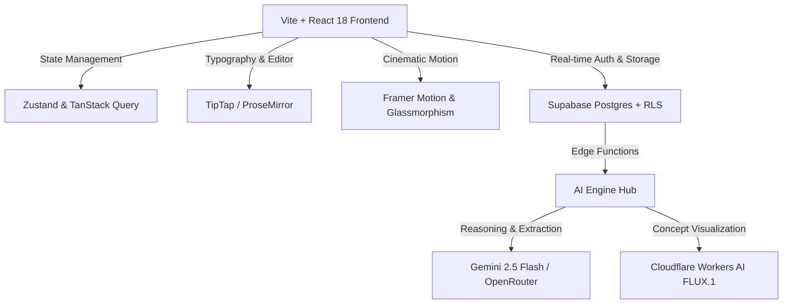

# 🎬 Knightora — The Cinematographer's AI Screenplay & Universe Studio

> *"Every great film begins in total darkness. A solitary cursor blinks like a lone streetlamp in the Venetian fog. Then, the first line is written—and an entire universe comes to life."*

---

## 📽️ Prologue: The Story Behind Knightora

Picture this: You are in the middle of a 120-page screenplay or a sprawling fantasy epic. 

Your fingers fly across the keys. The dialogue crackles with tension. But three acts deep, the fragile architecture of your world begins to creak. Did Matteo leave his mechanical astrolabe in the canal workshop in Scene 12, or is he suddenly holding it on the rooftops of Scene 45? Did Elena's eyes change from hazel to steel grey? What was the name of the tavern keeper from Act I?

In traditional filmmaking, keeping the world intact takes an army: a script supervisor with color-coded binders, a production designer sketching storyboards by candlelight, a dramaturg interrogating character motives, and a continuity editor reviewing every frame.

**Knightora is that entire film crew sitting quietly beside you at your desk.**

It blends the tactile, timeless elegance of a 19th-century bookbinder's desk with cutting-edge artificial intelligence. As you write, Knightora listens, remembers, audits, and paints your scenes in real time.

---

## 🎞️ The Reel: Core Capabilities

### 📜 1. The Parchment & The Slate (Dual-Mode Editor)
- **Seamless Transformation**: Shift instantaneously between industry-standard screenplay formatting (Courier Prime, sluglines, character dialogue, parentheticals) and sweeping novelistic prose.
- **The Quill Menu**: Highlight any line of dialogue or action block to summon an invisible director. Rewrite subtext, inject venom or melancholy into dialogue, expand sensory details, or push the pacing into overdrive.
- **Diff & Version Harmony**: Never lose a spark of inspiration. Compare AI-assisted drafts side-by-side against your original text before committing a single word.

### 🧠 2. The Script Supervisor (Automated Story Bible)
- **Passive World Extraction**: While you write, Knightora's neural parser reads between the lines, autonomously cataloging characters, recurring props, geographic locations, and pivotal timeline beats into a structured database.
- **Interactive Character Dossiers**: Track aliases, character arcs, physical traits, emotional wounds, and evolving alliances without touching a separate wiki.

### 🕵️‍♂️ 3. The Continuity Monitor (Narrative Auditing)
- **Contradiction Detection**: Catch narrative cracks before they turn into plot holes. Knightora flags timeline paradoxes, geographical impossibilities, trait contradictions, and characters resurrected without explanation.
- **One-Click Resolves**: Click any flagged discrepancy to jump straight to the offending scene and fix the continuity with pinpoint accuracy.

### 🔮 4. The Oracle (Universe Search & Citations)
- **Talk to Your World**: Press `Cmd/Ctrl + K` to interrogate your universe in plain English: *"Where was Elena when the astrolabe shattered?"* or *"Who possessed the Doge's seal before the uprising?"*
- **Source Citations**: Every answer is anchored with clickable citations linking directly back to the exact scenes and bible entries where the lore was forged.

### 🎨 5. The Production Designer's Lens (FLUX.1 Scene Visualization)
- **From Text to 35mm Frame**: Convert your scene descriptions and character dossiers into breathtaking concept art powered by FLUX.1 Schnell.
- **Cinematographer Controls**: Dial in anamorphic lenses, golden-hour lighting, film grain, noir shadow palettes, and wide tracking perspectives to visualize your film before a single shot is rendered.

---

## 🏗️ Architecture & Technology Stack



- **Frontend (`/frontend`)**: 
  - React 18, TypeScript, Vite, TailwindCSS (Knightora Violet Aurora Glassmorphism palette).
  - TipTap (ProseMirror engine) with custom screenplay and manuscript plugins.
  - Framer Motion for film-strip reel scrubbing and smooth UI transitions.
  - Zustand for zero-latency, reactive state orchestration.
- **Backend (`/supabase`)**:
  - **Database**: Supabase Postgres with strict Row Level Security (RLS) on all story projects, scenes, and lore items.
  - **Storage**: Asset buckets for generated concept art and project cover designs.
  - **Edge Functions**:
    - `ai-text-action`: Context-aware prose and dialogue revision.
    - `story-bible-extract`: Automatic extraction of entities, factions, and events.
    - `generate-image` & `generate-character-image`: Trait-consistent FLUX.1 concept rendering.
    - `consistency-check`: Logic and continuity conflict auditor.
    - `story-search`: Semantic lore search with grounded bible citations.
    - `ai-analyze`: Script reader diagnostics (pacing, emotional arc, dialogue punch).
    - `ai-brainstorm`: Creative twists, high-concept catalysts, and narrative forks.
    - `export-script`: Professional PDF, DOCX, Fountain, and Markdown exports.

---

## 🚀 Quickstart: Bringing the Studio to Life

### Prerequisites
- [Node.js](https://nodejs.org/) (version 18 or higher)
- [Supabase CLI](https://supabase.com/docs/guides/cli) (optional for local edge functions / containers)

### 1. Clone & Enter the Studio
```bash
git clone https://github.com/Steveroger77/Knightora.git
cd Knightora
```

### 2. Configure Environment
Create your local environment files from the provided templates:

```bash
# Frontend configuration
cp frontend/.env.example frontend/.env
```

Ensure your `frontend/.env` contains your Supabase project keys:
```env
VITE_SUPABASE_URL=https://your-project.supabase.co
VITE_SUPABASE_ANON_KEY=your-anon-key
VITE_OPENROUTER_API_KEY=your-openrouter-key # Optional: for direct AI client features
```

### 3. Install & Launch the Frontend
```bash
cd frontend
npm install
npm run dev
```

Open [http://localhost:3000](http://localhost:3000) in your browser to enter the studio.

---

## ⌨️ Director's Hotkeys

| Shortcut | Action |
| :--- | :--- |
| **`Cmd/Ctrl + \`** | Toggle Distraction-Free Full-Screen Writing Sanctuary |
| **`Cmd/Ctrl + S`** | Trigger Manual Cloud Autosave & Story Bible Sync |
| **`Cmd/Ctrl + K`** | Open Universe Search to interrogate lore in natural language |
| **`Text Selection`** | Summon "The Quill" Contextual AI Director Menu |
| **`?`** | Open Studio Keyboard Shortcuts Directory |

---

## 🎨 The Aesthetic: Violet Aurora Glassmorphism

Knightora’s interface was engineered to feel like standing in an illuminated editing bay at 2:00 AM:
- **`obsidian-950` (`#0B0A0C`)**: Deep nocturnal canvas minimizing eye strain across 10-hour writing sprints.
- **`aurora-500` / `violet`**: Ethereal bioluminescent accents denoting AI attention and active neural connections.
- **`parchment-100` (`#F4EDE0`)**: High-contrast, authentic manuscript texture calibrated for optical clarity.
- **`brass-400` (`#C9A15A`)**: Vintage mechanical accents honoring the golden age of cinema and physical typewriters.
- **`crimson-600` (`#8C2F39`)**: High-priority continuity flags demanding immediate authorial attention.

---

## 📜 License & Credits

Crafted for storytellers, screenwriters, and dreamers who refuse to let great stories die in development hell.

*FADE OUT.*
